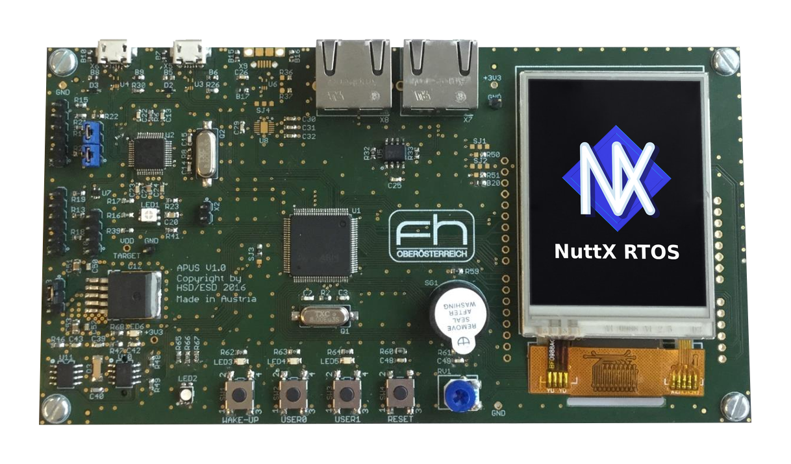
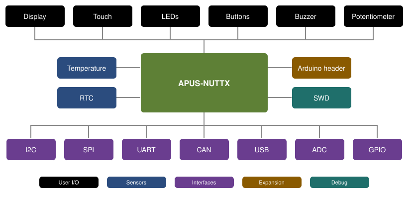

# apus-nuttx

NuttX board support for the **APUS board**, a development board built around the
STM32F072VBT6 (Arm Cortex-M0, 128 KB flash / 16 KB RAM).

[](https://github.com/apus-org/apus-nuttx/actions/workflows/build.yml)



## Overview



## Quick start

Clone NuttX, its apps and apus-nuttx next to each other:

```bash
mkdir nuttxspace
cd nuttxspace
git clone https://github.com/apache/nuttx.git nuttx
git clone https://github.com/apache/nuttx-apps apps
git clone https://github.com/apus-org/apus-nuttx.git
```

Build and flash the `nsh` configuration:

```bash
cd nuttx
./tools/configure.sh -l ../apus-nuttx/boards/apus/configs/nsh
make
openocd -f interface/stlink.cfg -f target/stm32f0x.cfg \
  -c 'program nuttx.bin 0x08000000 verify reset exit'
```

OpenOCD flashes through the on-board ST-Link.

## Requirements

NuttX and nuttx-apps `master`, the Arm GNU toolchain and kconfig-frontends. See the
[Installing guide](https://nuttx.apache.org/docs/latest/quickstart/install.html) for the
setup.

## Project layout

| Path | Contents |
|------|----------|
| [boards/](boards/) | board definition |
| [docs/](docs/) | documentation |

## License

Licensed under the Apache License, Version 2.0 ([LICENSE](LICENSE) or
<http://www.apache.org/licenses/LICENSE-2.0>).
